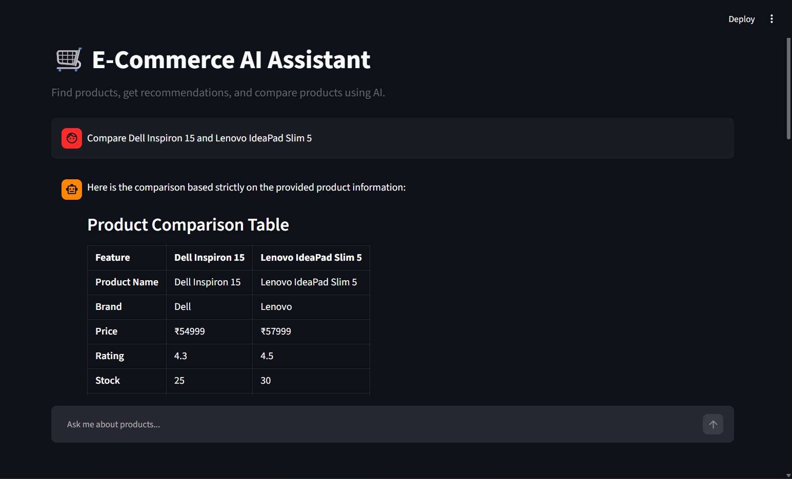

# 🛒 E-Commerce AI Chatbot

An AI-powered e-commerce shopping assistant built using **Python, Streamlit, FAISS, Sentence Transformers, and Google Gemini**.

The chatbot can search products, recommend products, compare products, answer store FAQs, and maintain conversation context.



## 🚀 Features

* 🔎 Semantic product search
* 🤖 AI-powered product recommendations
* 💰 Budget-aware recommendations
* ⭐ Rating-based product ranking
* ⚖️ Product comparison
* 📦 Product stock information
* ❓ FAQ / customer-support RAG
* 💬 Conversation memory
* 🧠 Retrieval-Augmented Generation (RAG)
* 🔥 FAISS vector database
* 🤗 Sentence Transformers embeddings
* 💎 Google Gemini LLM
* 🎨 Streamlit user interface

## 🏗️ Architecture

```text
User
 │
 ▼
Streamlit Chat UI
 │
 ▼
Intent Detection
 │
 ├── Product Query
 │      │
 │      ▼
 │   Sentence Transformers
 │      │
 │      ▼
 │   FAISS Vector Search
 │      │
 │      ▼
 │   Product Ranking
 │
 ├── FAQ Query
 │      │
 │      ▼
 │   FAQ Embeddings
 │      │
 │      ▼
 │   FAISS FAQ Search
 │
 └── Comparison Query
        │
        ▼
     Product Retrieval
 │
 ▼
Context + Conversation History
 │
 ▼
Google Gemini
 │
 ▼
AI Response
```

## 🛠️ Tech Stack

| Technology            | Purpose                   |
| --------------------- | ------------------------- |
| Python                | Backend                   |
| Streamlit             | Web interface             |
| Pandas                | Data processing           |
| Sentence Transformers | Text embeddings           |
| FAISS                 | Vector similarity search  |
| Google Gemini         | LLM / response generation |
| python-dotenv         | Environment variables     |

## 📁 Project Structure

```text
ecommerce-chatbot/
│
├── data/
│   ├── products.csv
│   └── faqs.csv
│
├── app.py                  # Streamlit chat UI (entry point)
├── product_search.py       # keyword product search
├── vector_search.py        # FAISS + Sentence Transformers search
├── faq_search.py           # FAQ retrieval
├── rag.py                  # retrieval-augmented generation with Gemini
├── test_data.py
├── test_search.py
├── test_vector_search.py
├── test_rag.py
├── screenshot.png
├── requirements.txt
├── .gitignore
└── README.md
```

## ⚙️ Installation

Clone the repository:

```bash
git clone https://github.com/shresth135/ecommerce-chatbot.git
cd ecommerce-chatbot
```

Create a virtual environment:

```bash
python -m venv .venv
```

Activate it on Windows:

```powershell
.\.venv\Scripts\activate
```

Install dependencies:

```bash
pip install -r requirements.txt
```

## 🔑 Gemini API Key

Create a `.env` file:

```env
GEMINI_API_KEY=your_api_key_here
```

Never upload the `.env` file to GitHub.

The project already contains `.env` in `.gitignore`.

## ▶️ Run the Application

```bash
streamlit run app.py
```

The application will open in your browser.

## 💬 Example Queries

### Product Search

```text
Find laptops under ₹60000
```

```text
Show me smartphones with good ratings
```

### Recommendations

```text
Recommend a laptop for programming
```

```text
Suggest a good phone under ₹70000
```

### Product Comparison

```text
Compare Dell Inspiron 15 and Lenovo IdeaPad Slim 5
```

### FAQ

```text
What is the delivery time?
```

```text
What is the return policy?
```

```text
Can I cancel my order?
```

### Conversation Memory

```text
I need a laptop under ₹60000
```

```text
Which one has the best rating?
```

## 🧠 RAG Pipeline

The project uses Retrieval-Augmented Generation.

Instead of asking the LLM to answer directly, the application first retrieves relevant information from the product or FAQ dataset.

```text
User Query
     ↓
Embedding
     ↓
FAISS Search
     ↓
Relevant Products / FAQs
     ↓
Context Construction
     ↓
Conversation History
     ↓
Gemini
     ↓
Final Answer
```

This helps reduce hallucination because Gemini receives the retrieved store information as context.

## 📊 Product Ranking

Products are ranked using multiple factors:

* Semantic relevance
* Product rating
* Stock availability
* User budget

This allows the chatbot to provide more useful recommendations than simple keyword search.

## 🔐 Security

The Gemini API key is stored in an environment variable:

```env
GEMINI_API_KEY=...
```

The `.env` file is excluded from Git using:

```gitignore
.env
```

Never commit API keys or other secrets.

## 🧪 Testing

Run the individual tests:

```bash
python test_data.py
```

```bash
python test_search.py
```

```bash
python test_vector_search.py
```

```bash
python test_rag.py
```

## ☁️ Deployment

The application can be deployed using Streamlit Community Cloud.

Before deployment:

1. Push the project to GitHub.
2. Make sure `.env` is not committed.
3. Add `GEMINI_API_KEY` as a Streamlit secret.
4. Select `app.py` as the application entry point.
5. Deploy.

## 🔮 Future Improvements

Possible future features:

* User authentication
* Shopping cart integration
* Order tracking
* Product images
* Product database/API integration
* PostgreSQL database
* Persistent conversation history
* User-specific recommendations
* Multilingual chatbot
* Voice input
* Agentic shopping workflow
* Payment integration
* Advanced evaluation and monitoring

## 👨‍💻 Project Goal

This project demonstrates practical implementation of:

* Natural Language Processing
* Vector databases
* Semantic search
* Retrieval-Augmented Generation
* Large Language Models
* Recommendation systems
* Conversational AI
* Streamlit application development

## 📄 License

This project is for educational and portfolio purposes.
